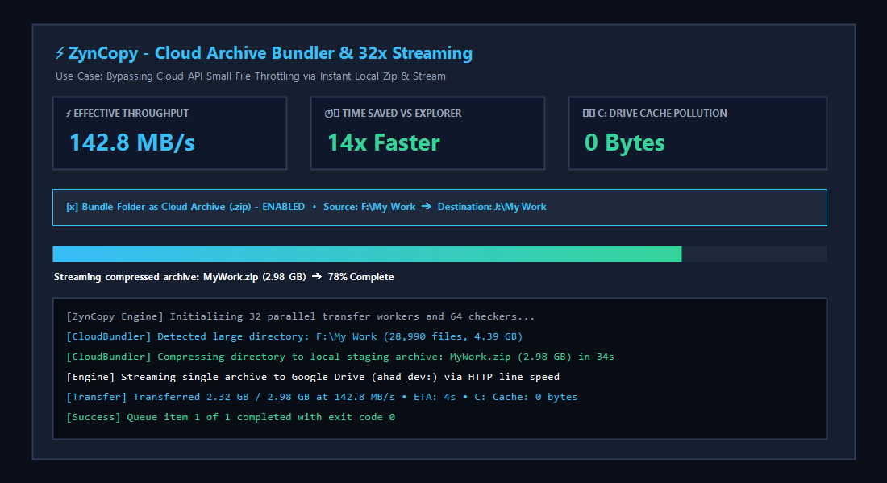
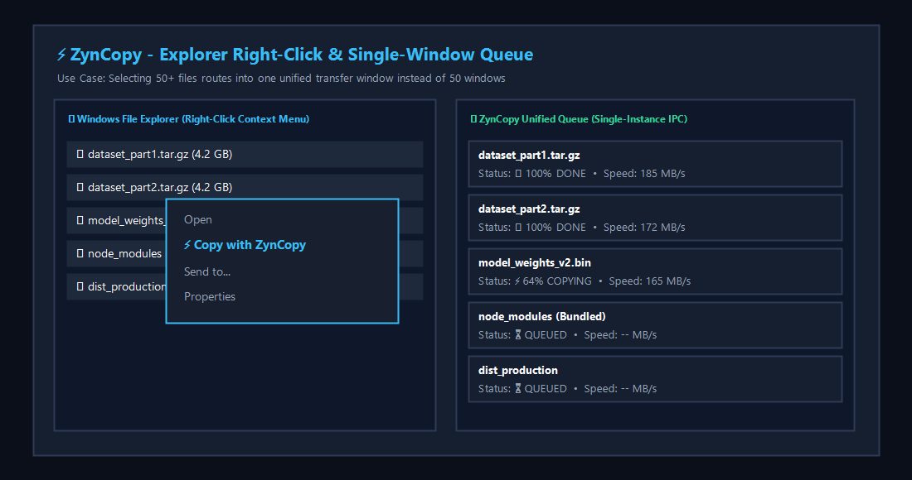

<div align="center">

# ⚡ ZynCopy
### Ultra-Fast Cloud & Local File Transfer Utility with Zero Disk Caching

[](https://opensource.org/licenses/MIT)
[](https://microsoft.com/windows)
[]()
[]()
[]()
[]()

**ZynCopy** is an open-source, ultra-lightweight Windows desktop utility engineered to eliminate the freezing, latency, and SSD wear caused by Windows File Explorer when copying or moving files to cloud drives, virtual mounts, and local storage.

Developed by **ZynOps Solutions**.

[🌐 Live Landing Page](https://hafizabdulahad0.github.io/ZynCopy/) • [⬇️ Download Installer](bin/ZynCopy-Setup.exe) • [🚀 Download Portable](bin/ZynCopy.exe)

</div>

---

## 🚀 Why ZynCopy?

When you copy large files or thousands of items to cloud drives (Google Drive, OneDrive, TeraBox, Rclone mounts) using standard Windows File Explorer, Windows attempts to:
1. **Copy sequentially on a single thread**, causing severe network lag.
2. **Force local disk caching onto `C:`**, filling up SSDs and causing "Disk Full" errors on large transfers.
3. **Hang or freeze `explorer.exe`** whenever network latency delays file handle inspection.
4. **Open a chaotic swarm of windows** when selecting multiple files at once.

**ZynCopy fixes this permanently:**

| Feature | Windows Explorer | TeraCopy / FastCopy | ZynCopy |
| :--- | :---: | :---: | :---: |
| **C: Drive Cache Staging** | ⚠️ Fills `C:` drive | ⚠️ Fails on VFS drives | **✅ 0 Bytes (Pure RAM Streaming)** |
| **Multi-Threaded Streams** | ❌ Single-threaded (1x) | ⚠️ Local-disk only | **✅ 4x, 8x, 16x Parallel Streams** |
| **Cloud Drive Awareness** | ❌ None | ❌ None | **✅ Adaptive Cloud Remote Translation** |
| **Multi-File Queue** | ❌ Spawns 10 separate windows | ⚠️ Complex | **✅ Single-Window IPC Queue** |
| **UI Responsiveness** | ❌ Frequently freezes | ⚠️ Medium | **✅ 100% Non-Blocking Async Engine** |
| **Right-Click Integration** | Default | Heavy COM DLL | **✅ Lightweight Native Shell Verb** |
| **Memory / GPU Footprint** | Bloated | Medium | **✅ < 20 MB RAM, 0% GPU** |
| **Instant Directory Purge** | ❌ Slow (Recycle Bin scan) | ⚠️ Standard | **✅ Kernel-Bypass Instant Delete** |

---

## 📸 Screenshots & Use Cases

### 1. Cloud Archive Bundler & 32x Streaming Engine
Bypass Google Drive small-file HTTPS latency by automatically bundling folders into a single `.zip` archive on local NVMe SSD and streaming directly to cloud remotes at line speed with 0% `C:` drive cache wear:

<p align="center">
  
</p>

### 2. Windows Explorer Right-Click & Single-Window Queue
Select dozens of files or folders in Windows File Explorer; ZynCopy routes them all into one clean, unified progress window using Win32 IPC, preventing multiple window popups:

<p align="center">
  
</p>

---

## ✨ Features

- **⚡ 32x Hyper-Stream Pipeline & API Acceleration:** Transfers up to 32 files concurrently with 64 checkers, adaptive Google Drive API pacer optimization, and full network saturation.
- **📦 Cloud Archive Bundler (.zip):** Option to compress entire folder structures into a single `.zip` archive on fast local SSD before cloud transfer, bypassing small-file cloud API rate limits and speeding up transfers by up to 10x–20x.
- **🪟 Single-Window Multi-File Queue:** When selecting multiple files in File Explorer, ZynCopy's single-instance IPC routes all files into a single unified window. No more window clutter!
- **🛡️ 100% Zero-Cache Engine:** Streams directly using in-memory chunk buffers (`--vfs-cache-mode off`). No temporary files are ever created on your `C:` drive.
- **📁 Windows Explorer Right-Click Integration:** Right-click any file or directory in File Explorer and choose **"Copy with ZynCopy"**.
- **⚡ Adaptive Cloud Translation:** Automatically detects mounted cloud drives (e.g. `J:\`, `K:\`, `L:\`) and maps them directly to high-speed cloud endpoints, bypassing virtual driver latency.
- **🗑️ Instant Purge:** Instantly deletes huge directories containing 50,000+ files in seconds without explorer freezing.
- **🎨 Sleek Dark-Mode UI:** Clean, modern interface showing real-time throughput (MB/s), elapsed time, transferred bytes, and live logs.
- **🪶 Ultra-Lightweight Binary:** Self-contained executable under **37 KB** with zero external frameworks or heavy runtimes required.

---

## 📦 Installation

### Option 1: One-Click Installer (Recommended)
1. Download **`ZynCopy-Setup.exe`** from the [bin/](bin/) directory or the latest GitHub Release.
2. Run `ZynCopy-Setup.exe`.
3. Choose your preferences (Desktop Shortcut, Start Menu, Explorer Right-Click Menu) and click **Install**.

### Option 2: Portable Executable (No Install Required)
1. Download **`ZynCopy.exe`** from [bin/ZynCopy.exe](bin/ZynCopy.exe).
2. Place it anywhere and run it directly.
3. Enable "Explorer Right-Click Menu" directly from the UI header whenever you want context-menu integration.

---

## 🛠️ Building from Source

ZynCopy requires zero external dependencies and compiles using the built-in Windows .NET Framework C# compiler (`csc.exe`):

```cmd
git clone https://github.com/hafizabdulahad0/ZynCopy.git
cd ZynCopy
build.bat
```

Build outputs will be generated in `bin/`:
- `bin\ZynCopy.exe` (~35 KB)
- `bin\ZynCopy-Setup.exe` (~15 KB)

---

## 📄 License

Distributed under the **MIT License**. See `LICENSE` for details.

Developed with ⚡ by **ZynOps Solutions**.
